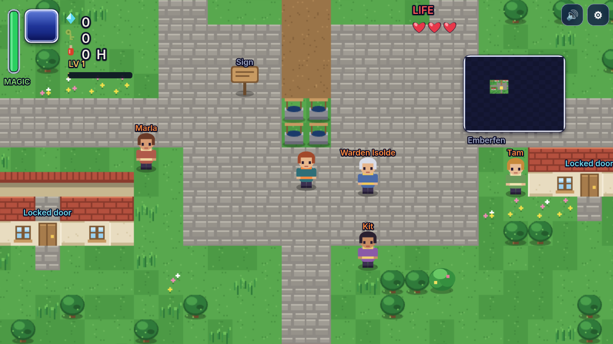

# Emberveil



An original top-down action-adventure for the browser (Phaser 3 + Vite + TypeScript). Stages 0-3: a playable game with: the Aurelane region, the town of Emberfen, two side quests, a shop and the first dungeon, the Cistern Under-Hall.

## Run
```
npm install
npm run dev          # http://localhost:5173 (also start `npm run server` for accounts; without it dev falls back to local accounts)
npm run check        # namecheck, tsc, mapgen freshness, reachability audit, headless bot, save validation, server smoke (Node 22.5+)
npm run browser      # real-browser test: keyboard/mouse input, mocked gamepad, viewport/DPR matrix, View zoom, Canvas-renderer text (needs the dev server and Chrome)
npm run browser:firefox   # optional: real Firefox with LibreWolf-like prefs (FIREFOX, FIREFOX_PROFILE_DIR, URL)
npm run perf         # texture memory / frame-time probe (URL=http://localhost:PORT/ node scripts/perf.mjs)
npm run shots        # screenshot tour into screenshots/
npm run build        # production bundle in dist/
```

## Controls
Keyboard and mouse: WASD / arrows move. Space or J or left click: sword (hold to charge a spin). Shift or K or right click: shield. L or R: roll. Q: item (Gale Disc, Spiral Boots, Ember Bow; C cycles). E or Enter: talk / open. H: Ember Tonic. M: map. Esc: menu. F10: settings. Touch: stick plus on-screen buttons.

Gamepad (standard mapping; Xbox, PlayStation and most others; plug in or pair, then press any button):

| Control | Action |
| --- | --- |
| Left stick / D-pad | Move; navigate menus (hold to repeat) |
| A (PS: cross) | Interact, talk, confirm |
| B (PS: circle) | Cancel, back, close menus |
| X (PS: square) | Sword (hold to charge a spin) |
| Y (PS: triangle) | Use the equipped item |
| LB / RB | Previous / next item |
| LT | Shield (hold) |
| RT | Roll / dash |
| Start / Options | Pause menu |
| Back / Select / Create | Map |
| R3 (stick click) | Ember Tonic |

A toast announces a controller being plugged in or removed. While a pad is in use the touch buttons hide and on-screen hints (item key, menus, title) show pad button names; using the keyboard, mouse or touch brings the usual hints back. The settings panel and sign-in form can be driven with the pad too (D-pad moves focus, A presses, B closes). Settings > Controller has a stick dead zone slider (default 25%); the Controls tab lists every button.

## View zoom and scaling
The picture always fills the browser window. World zoom is derived from the real CSS size of the canvas's parent (`#game`, via ResizeObserver) and never from `screen.*` or a bare `devicePixelRatio`, so hardened browsers (Firefox `privacy.resistFingerprinting`, LibreWolf, which pin DPR or round `innerWidth`/`innerHeight`), browser zoom and `layout.css.devPixelsPerPx` all behave. At least 20 x 14 tiles are always visible. Settings > Display > View zoom: Auto, Closer or Wider (persisted).
When WebGL is unavailable (LibreWolf disables it by default) Phaser falls back to its Canvas renderer; `label()` in `src/ui.ts` keeps text at its logical size there (see `scripts/browser-test.mjs`, `scripts/firefox-test.mjs`).

## Layout
- `src/sim/` Phaser-free simulation: `core.ts` (movement, combat, doors, keys, quests, shop, save, fog), `enemies.ts` (state machines), `maps.ts` (chunk/room loader), `data.ts`, `npcs.ts`, `types.ts`, `node.ts`.
- `src/scenes/` boot, title, game (renderer: chunk streaming and culling, sprites, labels, effects).
- `src/art.ts` tile painter, `src/sprites.ts` sprite painters, `src/hud.ts`, `src/menu.ts`, `src/mapview.ts`, `src/input.ts`, `src/audio.ts` (24 tracks, sfx), `src/save.ts`, accounts/settings/touch UI.
- `tools/mapgen.ts` generates `public/world/**` and `server/content.json`.
- `server/` accounts server (sessions, CSRF, hardening), `save.mjs` (whitelist validation), `smoke.mjs`.
- `scripts/` namecheck, audit, bot, selfcheck, shot, browser-test.

## Stage 2 (done)
World chunks are baked at `CHUNK_TEX` (2) px per unit from a pool of canvas textures; the playable scene and Phaser are separate bundles. Water shimmers, dark rooms carve soft light, and the hero earns XP/levels (SaveV2; v1 saves migrate). See PROGRESS.md.

## Stage 3
- **Skyreach Spire** (dungeon 3, five floors, 17 rooms): unlocked by the Bark Warden. Three small keys, a crystal switch that needs a ranged strike, the Belfry Key from mini-boss Cloudmarshal Vesk, the big chest with the **Ember Bow** (Q, 1 magic per fire arrow; burns thorn thickets, strikes switches and grounds flyers) and boss **Stormfinch Mol** (airborne: only arrows or the Gale Disc hurt it; three phases). Heart container on the roost.
- **Music**: 24 procedural tracks, with distinct themes for the castle, woods, desert, swamp, lake, mountains, plateau, Mossgate, Skyreach and the Keep, plus boss variants (Sluicejaw, Bark Warden, Stormfinch, Vael).
- **Allies**: Kit (light bolts) and Dorn (blade) are recruited by finishing their side quests ("Kit's Little Lamp", "The Old Medal"). They follow, fight, earn their own XP and level up to 5 with the same level-up effect as the hero. Stored in `save.allies` (id -> XP) and checked by the server (never leave, never lose XP).
- **Crownwatch Keep** (three rooms south of the castle): opens only when the Cistern, Mossgate and Skyreach lamps burn. Final boss **Vael Orsek** (three phases: slashes and volleys, blink and rings, bursts). Defeating him plays the ending and scrolling credits (confirm to keep exploring).
- **Quests**: 4 main and 10 side quests (Maple's hen, Oswin's lantern, Pell's folio, Ferris's parcel, Nell's feather, Mossa's waterskin, Dorn's medal, Willa's pearl, Tove's bell rope, Kit's lamp), 17 NPCs.
- **Checks**: `npm run check` adds Spire, Keep, ally, ending and boss-tuning bounds (stationary damage per second of each boss); the audit also cross-checks quests, NPCs, allies, quest items and warp flags.
- Fixed while testing: locked doors on east/west walls could not be opened (contact margin ignored the hero's width); burnt thickets were missing from the server whitelist; the server's heart cap no longer rejects saves with three heart containers.
